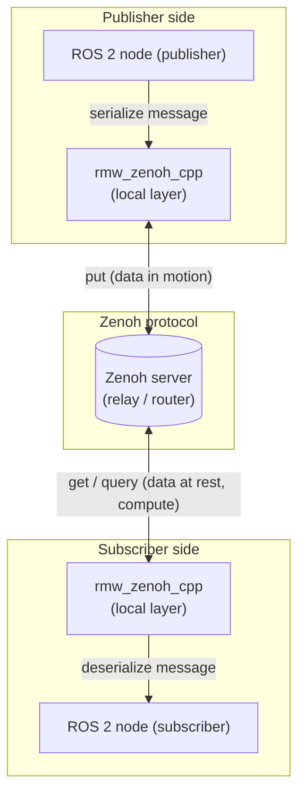

This document provides instructions on how to easily set up and use Zenoh DDS as the underlying middleware.

## **What Is Zenoh DDS?**

Zenoh is a pub/sub/query protocol that unifies data in motion, data at rest and computations. That said, one way of thinking about Zenoh is to imagine it as a data liberator protocol. Zenoh liberates data in several dimensions.

The diagram below shows how this setup fits together: your ROS 2 nodes no longer talk directly to each other over the DDS network, but instead (de)serialize their messages and pass them to their local `rmw_zenoh_cpp` layer, which routes them through the Zenoh server. The server then relays messages between the local and remote `rmw_zenoh_cpp` layers, and each node's layer reconstructs them before handoff to the node. The whole stack is coordinated by `RMW_IMPLEMENTATION=rmw_zenoh_cpp`, which tells every node's middleware runtime to use the Zenoh backend.

## **Why Set This Up?**

In the context of Robot Middleware Framework (RMF), it has been strongly hinted by maintainers that the Zenoh DDS will be de-facto DDS used for RMF-enabled components going forward.

For general ROS 2 development best practices, Zenoh offers a rust-based and memory-safe approach for communications between ROS 2-based applications going forward.

## **Dependencies**

- A ROS 2-based distribution

> [!NOTE]
> Zenoh DDS is only officially supported on ROS 2 Jazzy, but `rmw_zenoh_cpp` is also packaged for later distros. Each of the following instructions shows per-distro variants in switchable tabs.

## **Instructions** 📘

To get your ROS 2 components running with Zenoh, there are 2 critical steps to do as follows:

- **Start** a Zenoh server.
- **Ensure** your custom ROS package is communicating with `RMW_IMPLEMENTATION` set to `rmw_zenoh_cpp`.

These instructions assumes that you are running on a Linux operating system such as Ubuntu. **Use** the tabs above each code block to pick your ROS 2 distro:

1\. **Install** `rmw_zenoh_cpp` for your distro:

> [!TIP]
> **Switch** between distros with the tabs before any of the code blocks below.

Jazzy|sudo apt-get update && sudo apt-get install ros-jazzy-rmw-zenoh-cpp||Lyrical|sudo apt-get update && sudo apt-get install ros-lyrical-rmw-zenoh-cpp


2\. **Start** the Zenoh server:

Jazzy|source /opt/ros/jazzy/setup.bash && ros2 run rmw_zenoh_cpp rmw_zenohd||Lyrical|source /opt/ros/lyrical/setup.bash && ros2 run rmw_zenoh_cpp rmw_zenohd


3\. **Switch** the default DDS to `rmw_zenoh_cpp`:

export RMW_IMPLEMENTATION=rmw_zenoh_cpp



4\. **Run** your ROS 2 package.

Here is a quick and easy way of starting up a Zenoh-based Server:

Jazzy|docker run -it --rm \
;;	--name zenoh_server_c \
;;	-e RMW_IMPLEMENTATION=rmw_zenoh_cpp \
;;	--network host \
;;	cardboardcode/zenoh_server:jazzy bash -c "source /ros_entrypoint.sh && ros2 run rmw_zenoh_cpp rmw_zenohd"||Lyrical|docker run -it --rm \
;;	--name zenoh_server_c \
;;	-e RMW_IMPLEMENTATION=rmw_zenoh_cpp \
;;	--network host \
;;	cardboardcode/zenoh_server:lyrical bash -c "source /ros_entrypoint.sh && ros2 run rmw_zenoh_cpp rmw_zenohd"


## **References**

- [rmw_zenoh](https://github.com/ros2/rmw_zenoh)
- [zenoh-plugin-ros2dds](https://github.com/eclipse-zenoh/zenoh-plugin-ros2dds)
- [What is Zenoh?](https://zenoh.io/docs/overview/what-is-zenoh/)
